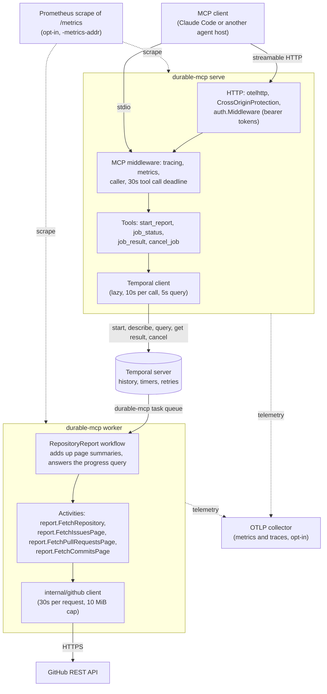
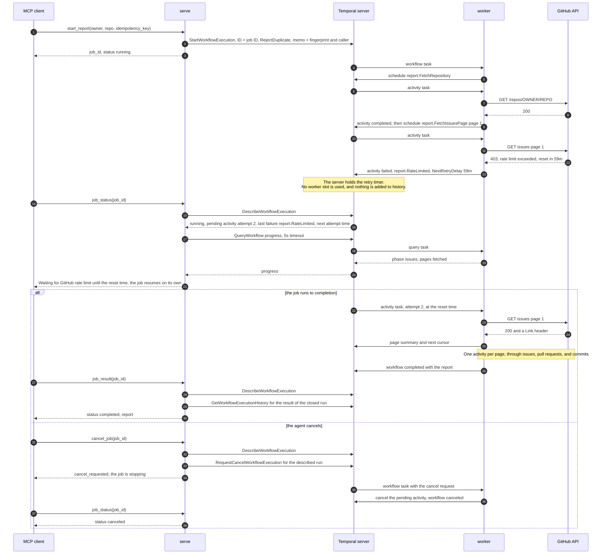

# Architecture

durable-mcp has two roles, built into one binary: `serve`, the MCP server that agents talk to, and `worker`, the
Temporal worker that does the work. They never talk to each other directly. Everything about a job lives in Temporal,
and the two roles meet there. This page shows how the parts fit and where each kind of data lives. The reasons behind
the main choices are in [decisions.md](decisions.md), and the details are in the package documentation linked below.

## Components

- **`serve`** ([`cmd/durable-mcp/serve.go`](../cmd/durable-mcp/serve.go), [`internal/mcpserver`](../internal/mcpserver/doc.go))
  keeps no state. Over HTTP it runs the MCP SDK's streamable handler in stateless mode with plain JSON responses, so each
  request stands alone and replicas need no session affinity. Over stdio, the MCP host that started it is its only
  caller, and the HTTP layer (and so auth) is not there. Its Temporal client is lazy: `serve` starts and lists its tools
  even while Temporal is down, and the tools say Temporal is unreachable until it is back.
- **`worker`** ([`cmd/durable-mcp/worker.go`](../cmd/durable-mcp/worker.go), [`internal/report`](../internal/report/doc.go))
  connects to Temporal at startup and exits with an error if it cannot. It runs at most 4 activities at once, because
  every report on a worker shares its GitHub token and GitHub counts concurrent requests against its secondary rate
  limit. It is the only part that reads `GITHUB_TOKEN`.
- **The GitHub client** ([`internal/github`](../internal/github/doc.go)) is written on `net/http`. It never sleeps or
  retries: it returns typed errors, including a `*RateLimitError` with the time a retry can succeed, and refuses any URL
  it did not build that leaves the configured API (next-page links, cursors, redirects), so the token never goes
  anywhere else.

## A job, from start to result

The agent starts a report, polls it while it waits out a rate limit, and fetches the result. The `alt` block at the end
shows the other ending, where the agent cancels instead.

Every tool that takes a job ID first describes the job, which checks that the ID names a `RepositoryReport` workflow and that the job
belongs to the caller. `job_status` queries progress only while the job is open, since a query of a closed job would
make a worker replay its whole history on every poll. If no worker answers the query, `job_status` answers without
progress instead of waiting. A cancellation that reaches an activity while its request is in flight arrives through the
activity's heartbeat, and the SDK cancels the activity's context, which aborts the request.

## What lives in workflow history, and what does not

Temporal stores a workflow's input, its activities' inputs and results, and its result in the workflow's history, and
keeps it for the namespace's retention period. So what goes in there is a design decision, both for size and for what
an operator with access to the namespace can read.

**In history:**

- The request: owner, repo, the window, and the page limit. The memo holds the request's fingerprint (a hash) and the
  caller's name. The workflow's summary is "Report on OWNER/REPO".
- For each page, one activity's input (owner, repo, window, page number, and the cursor: the next-page URL on the
  configured API) and its result, a compact partial aggregate: counts of issues and pull requests by state and close
  reason, the seconds from creation to merge of each merged pull request (a median cannot be combined from per-page
  medians), commits per week, and commits per author login. The repository activity's result is its name,
  description, URL, default branch, stars, forks, and whether it is archived.
- The final report, as the workflow's result, or the failure that ended it, with its type and message.

**Not in history:**

- No issue or pull request titles, bodies, or comments, and no commit messages: an activity reduces its page before
  it returns. History therefore grows with the number of pages, not with the data. Each page adds six events, and
  `max_pages` (at most 200 per resource) bounds a report at about 3,600 events and 2 MB, under the 4,096 events at
  which the server suggests continue-as-new, so the workflow never needs it. A resource with more pages is reported as
  truncated. See [History size](../internal/report/doc.go).
- No credentials. The GitHub token stays in the worker's environment and the HTTP client's headers. `serve` holds only
  SHA-256 hashes of bearer tokens and passes on the caller's name, never a token. The idempotency key is not stored
  either: only its hash, as part of the job ID.
- No failed attempts that are still being retried, such as a page waiting out a rate limit. Temporal keeps those in
  the pending activity (attempt, last failure, next attempt time), which is why `job_status` reads it with
  `DescribeWorkflowExecution`, and why the `progress` query does not show them.
- No progress state of its own. The phase and page counts are workflow variables, rebuilt by replay and read by the
  `progress` query.

## Job identity and per-caller isolation

A job ID is the workflow ID: `report-` and 26 lowercase base32 characters. Without an idempotency key it is random
(130 bits from `crypto/rand`). With one, it is the first 128 bits of a SHA-256 of the caller's name and the key, so a
retry with the same key names the same workflow. The ID reuse policy, `RejectDuplicate`, refuses to start that ID twice,
even after the first run finished, and the conflict policy `Fail` makes a duplicate start an error instead of
attaching to the running job. `start_report` then compares the request's fingerprint with the one in the job's memo: a
match returns the existing job with `created: false`, and a mismatch is an error. Details are in
[`internal/mcpserver/jobid.go`](../internal/mcpserver/jobid.go) and [`start.go`](../internal/mcpserver/start.go).

The caller comes from the bearer token's entry name: `auth.Middleware` hands it to the MCP SDK as the request's token
info, and an MCP middleware puts it in the tool call's context. It is part of the key hash (under a `job/v2` domain, so
two callers with the same key get two jobs) and is stored in the job's memo. Every tool that takes a job ID returns the
same not-found error, byte for byte, for an ID that does not exist, a workflow that is not a report, and another
caller's job. An unreadable owner counts as another caller's. Jobs started over stdio or without tokens belong to the
empty caller, keep the hash formula from before callers existed, and are visible only to the empty caller.

## Error taxonomy

There are two kinds of error, and they reach the agent differently:

- **Tool errors** (`IsError` results) are for calls that could not be answered: invalid arguments, an unknown job ID,
  Temporal being unreachable, or the tool call deadline passing. Each says what happened and what is safe to do next,
  such as "retrying with the same `idempotency_key` is safe". Temporal's error details go to the log, not to the agent.
- **A failed job is not a tool error.** `job_result` describes it, with a type, a message, and `retryable`, which says
  whether a new report with the same arguments could succeed.

The chain from GitHub's answer to the agent's next step has one type per failure and one retry decision per type:

| GitHub client error | Activity failure type | Temporal retries | `job_result`: retryable, next step |
|---|---|---|---|
| `*RateLimitError` (primary or secondary) | `report.RateLimited` | Yes, at `NextRetryDelay` from GitHub's reset time (a growing backoff for repeated secondary limits); benign, so left out of failure metrics | Yes: start a new report later, or give the worker a token with a higher limit |
| 5xx or 408, network error, request timeout, a body that does not decode | `report.Unavailable` | Yes, exponential backoff from 1s to 1m, at most 10 attempts | Yes: start a new report in a few minutes |
| An attempt that times out (start-to-close or heartbeat) on its last try, or the job's 24-hour timeout | `Timeout` | Attempts: yes, per the retry policy | Yes: start a new report in a few minutes, or with a shorter window |
| 401 | `report.Unauthorized` | No | No: the operator must fix `GITHUB_TOKEN` |
| 403 that is not a rate limit | `report.Forbidden` | No | No: the token cannot read this repository |
| 404 | `report.NotFound` | No | No: check owner and repo |
| 422 | `report.ValidationFailed` | No | No: fix the arguments |
| Any other 4xx | `report.RequestRejected` | No | No: tell the user |
| A response over 10 MiB | `report.ResponseTooLarge` | No | No: tell the user |
| An invalid argument, or an invalid request caught by the workflow | `report.InvalidRequest` | No | No: fix the arguments |
| A next-page link or redirect off the configured API | `report.LinkRefused` | No | No: the operator must check the GitHub API URL |
| A cursor from history the client rejects, a request it cannot build, the client's page limit | `report.Internal` | No | No: tell the user, with the job ID |
| Anything else | `Unknown` | | No: if it fails again, stop and tell the user |

The activity side is `activityError` in [`internal/report/errors.go`](../internal/report/errors.go), and the tool side is
`failureKinds` in [`internal/mcpserver/result.go`](../internal/mcpserver/result.go). `TestFailureTaxonomy` pins the
whole chain, from a fake GitHub status to the `job_result` the agent sees. Failures recorded before the `report.`
prefix have unprefixed types, and `NormalizeErrorType` maps them to the current ones. While a job is still retrying,
`job_status` shows the same types in `current_step.last_failure`.

## Timeouts

Every wait has a bound, and each layer's bound fits inside the one above it: the GitHub request (30s) inside the
activity attempt (1m), the attempts inside a page's 2-hour budget, the pages inside the job's 24 hours; on the other
side, each Temporal call (10s, or 5s for the query) inside the tool call deadline (30s), inside the HTTP write timeout
(1m). The full chain, with the reason for each value, is the [Timeouts table in the README](../README.md#timeouts).

## Observability

Telemetry is off by default: a plain run makes no network calls and opens no extra port. It is set up in
[`internal/telemetry`](../internal/telemetry/telemetry.go); the [README](../README.md#observability) lists every metric.

- **Metrics** go to OTLP when the `OTEL_*` variables ask for them, and to a Prometheus `/metrics` on a private registry
  with `-metrics-addr` (a bare `:port` means loopback). They cover tool calls (`mcp.server.operation.duration`), jobs
  started (in `serve`) and finished (by the workflow, after it returns, skipping replays), activity attempts (through a
  worker interceptor, so they count the retries that history leaves out), rate-limit waits, HTTP requests on both
  sides, and the Temporal SDK's own metrics. Every attribute comes from a fixed set: unknown tool and method names
  become `_OTHER`, and no metric is labeled with a job ID, repository, or caller. The HTTP server metrics drop
  `server.address` and `server.port`, which come from the client's `Host` header and would let unauthenticated
  requests create time series.
- **Traces** go to OTLP only. One trace follows a job: the `POST /mcp` span (outside auth, so 401s are traced), a span
  per tool call, the Temporal tracing interceptor's spans from `StartWorkflow` through the workflow and each activity,
  and the GitHub request. No trace context is sent to GitHub. Every span passes through a redaction policy before
  export: header attributes are dropped, query values other than known GitHub parameters become `REDACTED`, and bearer
  and token-shaped strings in any other text are redacted. `TestSpansHoldNoCredentials` sends a canary token through
  an authenticated request, a rejected one, and the GitHub client, and checks that it is in no span.
- **The dashboard**, [`deploy/grafana/durable-mcp.json`](../deploy/grafana/durable-mcp.json), charts tool calls, jobs,
  GitHub requests, rate-limit waits, and activity attempts. `TestDashboardMetricsAreEmitted` keeps it in step with the
  code: it runs real tool calls, a rejected token, and report workflows against a fake GitHub API through the same
  Prometheus exporter `-metrics-addr` serves, and fails if any panel's query names a metric or label that is not in the
  scrape.

## Deployment

The [`Dockerfile`](../Dockerfile) builds one image for both roles: a static Go binary on distroless `static`, running as
user 65532, with no shell. The command picks the role (`serve` or `worker`). The image exposes only 8080, the MCP HTTP
port; `/metrics` has no authentication, so its port is left out and has to be published on purpose.

`serve` listens beyond loopback only with auth tokens, so in a container, where it has to listen on `0.0.0.0`, it needs
a tokens file. Without tokens it refuses any address that is not a loopback IP.

Both roles stop gracefully on SIGTERM, and a second signal ends the process at once. A stopping worker gives running
activities up to a minute, the same as one attempt's start-to-close timeout, so a page being fetched can finish
instead of being retried elsewhere. That is why the container needs a stop grace period of at least 70 seconds
(`docker stop -t 70`, `stop_grace_period: 70s` in Compose, `terminationGracePeriodSeconds: 70` on Kubernetes).

[`deploy/compose/compose.yaml`](../deploy/compose/compose.yaml) runs a Temporal development server, the worker, and
`serve` on one machine for trying it out, with every port on `127.0.0.1`. The CI `image` job builds the image and checks
that it runs as non-root, refuses an unauthenticated `0.0.0.0`, answers 401 and 200 with a mounted tokens file, serves
a metrics scrape, stops cleanly within 70 seconds, and logs no token, and it runs the Compose example with a real
development server.

Workers can scale out on the same task queue. Deploy a new version to all of them at once: since the activities took
their `report.` names, a worker from before the rename cannot run the activities that new runs schedule. See
[decision 6](decisions.md#6-rename-activities-without-getversion).
